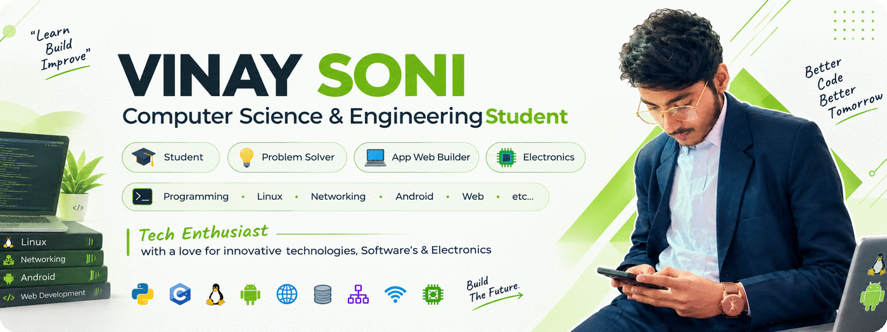

  

# 
💻💭 **Vinay Sanjay Soni**

  
<strong>Hey there!</strong> 👋 I'm Vinay Soni — a <strong>Computer Science &amp; Engineering student</strong> and tech enthusiast, building things for the web and tinkering with electronics in Balaghat, MP.

  

    
    
  

  
a passion for leveraging innovative technologies to solve real-world problems and drive product evolution. With a strong foundation in Technology Development | Business Management and a deep understanding of modern systems, I specialize in crafting scalable, efficient, and user-centered digital solutions.

I don’t just write code — I architect platforms, lead teams, and shape technical strategy to align with business vision. From idea to execution, I’m driven by impact, scalability, and long-term innovation. I thrive at the intersection of technology, product, and leadership, transforming complex challenges into breakthrough opportunities.

  
  

## 📌 About Me

<table>
<tr>

<td width="50%" valign="top">

### What I Do 👨🏻‍🎓

I focus on transforming ideas into meaningful digital products by blending strong technical depth with strategic thinking. My work goes beyond implementation—I aim to understand problems at their core and turn complex challenges into clear, scalable, and impactful solutions that deliver long-term value.

I specialize in designing and evolving scalable platforms, shaping long-term technical direction, and making architectural decisions that balance performance, reliability, security, and future growth. I enjoy working at the intersection of technology, product vision, and leadership, where thoughtful engineering meets real-world impact.

I actively work with modern cloud platforms to build reliable, efficient, and scalable infrastructure. I follow cloud-native principles, focus on system resilience and optimization, and continuously explore emerging technologies while staying grounded in proven engineering fundamentals.

— Vinay Sanjay Soni

☁️ Cloud Platforms & Infrastructure Experience
 

ㅤ

</td>

<td width="50%" valign="top">

### Technical Expertise 🔍

My technical expertise covers a broad spectrum of back-end and system-level technologies, allowing me to architect clean, scalable, and production-ready solutions across diverse environments.

 

<strong>Back-End & Core Technologies</strong>

 

 

 

<strong>Things I Master</strong>

 

</td>

</tr>
</table>

